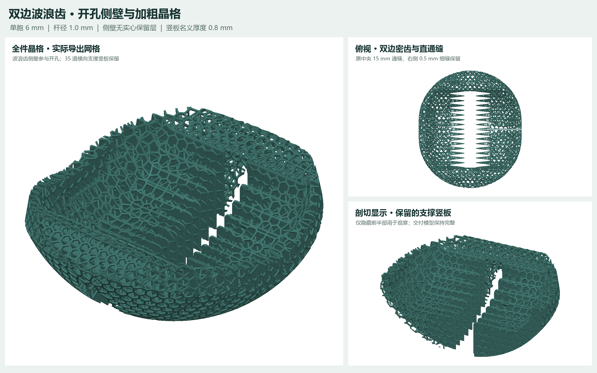

# 双边波浪齿：开放侧壁晶格版本

2026-11-16 更新：取消波浪齿侧壁的实心保留，单胞由 4 mm 增大到 6 mm，
杆径由 0.6 mm 增大到 1.0 mm。保留原有横向支撑竖板。

## 参数

| 项目 | 当前值 |
|---|---|
| 单侧齿深 | 20 mm |
| 波浪节距 | 6.5 mm，每侧 16 个周期 |
| 晶格 | BCC，单胞 6 mm、杆径 1.0 mm |
| 外表面 | 六角开孔，孔距随单胞、筋宽随杆径 |
| 波浪侧壁 | 64 张侧壁全部参与开孔，不保留实心层 |
| 横向竖板 | 35 道，名义厚度 0.8 mm |
| 直通缝 | 中央 15 mm、右侧 0.5 mm |
| 采样与平滑 | 0.2 mm、2 次 |

0.8 mm 是竖板的名义厚度，栅格、平滑与原曲面裁切会产生局部误差；
细缝避让的两道竖板在此前版本约为 0.75 mm。杆件交汇处会自然加厚。



## 下载

- [3MF 打印模型](https://github.com/maolin2501/3dhex/releases/download/waist-open-wave-2026-11-16/open_wave_lattice.3mf)
- [STL 压缩包](https://github.com/maolin2501/3dhex/releases/download/waist-open-wave-2026-11-16/open_wave_lattice_stl.zip)
- [双边波浪齿 STEP 输入](waist_bilateral_dense_wave_20261113/bilateral_dense_wave_20mm.step)

所有打印文件使用毫米，最低点置于 Z=0。3MF 与 STL 使用相同的索引网格几何。
模型不包含打印机、材料、支撑或切片参数。

## 安装与复现

按 [Lattice Studio 安装说明](LATTICE_STUDIO.md#在其他电脑安装) 安装 Python 3.12、
`requirements_studio.txt` 中的依赖以及 Three.js。以下命令均在仓库根目录运行。

```powershell
$cadPython = '.\.lattice-env\Scripts\python.exe'

# 从仓库中的 STEP 构建 CAD 面映射和原有竖板中面
& $cadPython waist_bilateral_lattice_ribs_20261113/prepare_model.py

# 应用当前参数，清空侧壁实心保留，然后生成全件晶格
& $cadPython waist_bilateral_open_waves_20261116/prepare_revision.py
& $cadPython waist_bilateral_open_waves_20261116/generate_revision.py

# 分开导出，降低大模型导出时的峰值内存
& $cadPython waist_bilateral_open_waves_20261116/export_stl_low_memory.py
& $cadPython waist_bilateral_open_waves_20261116/export_compact_3mf.py

# 检查竖板、两处缝隙、每张波浪侧壁的真实孔区和序列化网格
& $cadPython waist_bilateral_open_waves_20261116/verify_revision.py
& $cadPython waist_bilateral_open_waves_20261116/verify_stl.py
& $cadPython waist_bilateral_open_waves_20261116/render_final.py
```

全件使用约两亿采样点，采用磁盘分块计算。运行前需留出足够内存和数 GB 临时磁盘空间。
`model/`、`pretrim/`、网格及临时数组是本机生成物，不进入 Git。

原 CAD 波浪齿也可通过 `waist_bilateral_dense_wave_20261113/build_bilateral.py` 重建；
原始临时 STEP 附件已过期，仓库中的 `waist_wave_teeth_20261112/source.brep` 保存了导入时的原始实体。

## 测试

```powershell
& $cadPython -m unittest discover -s tests_lattice_studio -p 'test_*.py' -v
node tests_lattice_studio/test_face_thickness_ui.mjs
```

设计几何检查结果保存在当前案例目录的 `verification.json`、`stl_verification.json`
和 `3mf_verification.json` 中。它们验证几何与文件完整性，不代表力学或打印工艺验证。
## 局部连通与验证

取消实心侧壁并改用 6 mm 单胞后，原曲面裁切留下 39 段独立小杆。
本版本保留这些材料，在同侧原实体内部添加 39 根名义直径 1 mm 的短杆连接。
新增材料 32.676 mm³，约占材料体积的 0.041%；没有恢复实心侧壁层。

每根连接杆都与源实体求交；检查裁后单体、有效截面、两端的实体重叠。
最小采样截面积为 0.472 mm²，两端截面积至少 0.1 mm² 的连续重叠长度
均超过 0.24 mm。`connection_verification.json` 逐根记录位置、长度和检查结果。
原生成阶段的顶点路由统计在 `result.json` 中明确标记为修复前统计。

`generate_revision.py` 在发现实际材料岛时保存裁切检查点，并依次调用
`diagnose_components.py`、`plan_connections.py` 和 `connect_islands.py` 完成局部连接。
若需恢复已保存的裁切前计算，可单独按上述三个脚本的顺序运行。
诊断先检查每个壳的有符号体积，避免把封闭内孔误认为材料岛。

最终文件有 17,462,384 个三角面，材料体积 79,774.175 mm³，为原实体体积的 24.394%。
64 张波浪侧壁共 28,706 个有效采样检查，每张都有真实孔区；35 道竖板共
2,388 个采样通过；168 组缝隙检查通过。最终为一个闭合连通实体。
STL 逐三角面与索引网格核对，无零面积或重复顶点三角面。
3MF 的完整解压、CRC、XML、记录数量与数据摘要校验均通过。

3MF 约 259 MB，未压缩 STL 约 873 MB。两种格式保持相同几何；
3MF 减少存储占用，不再对薄杆进行激进减面。`release_manifest.json` 提供下载文件的 SHA-256。
