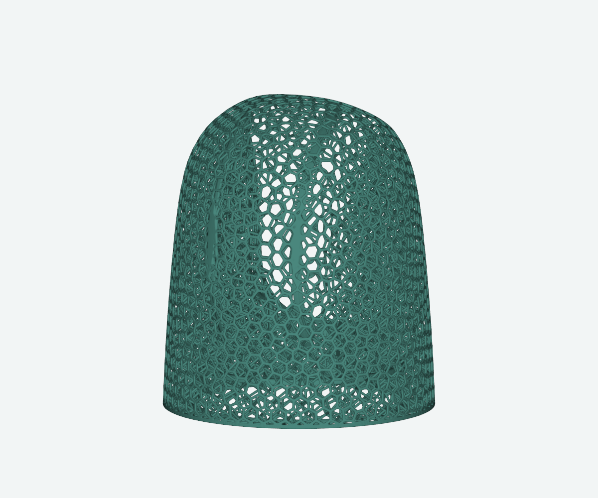
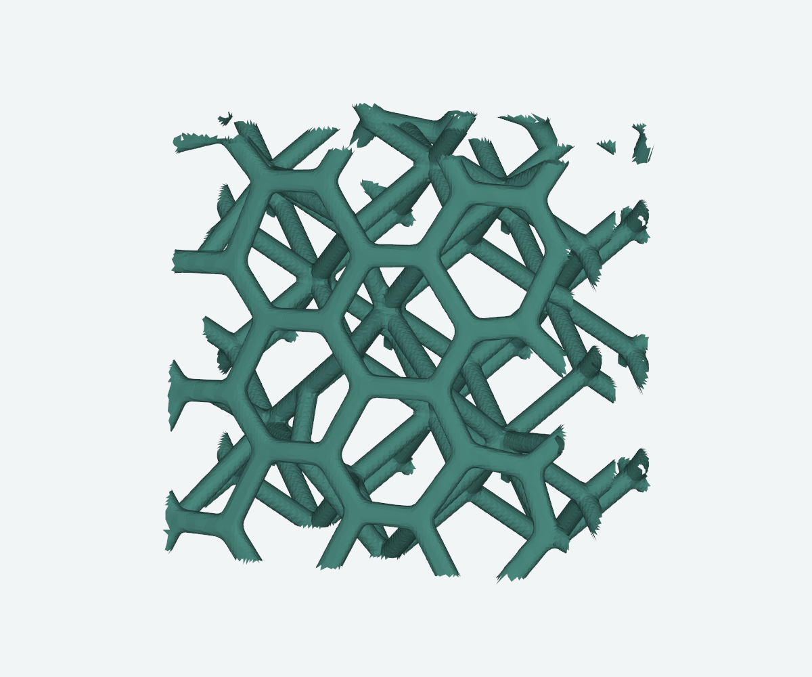
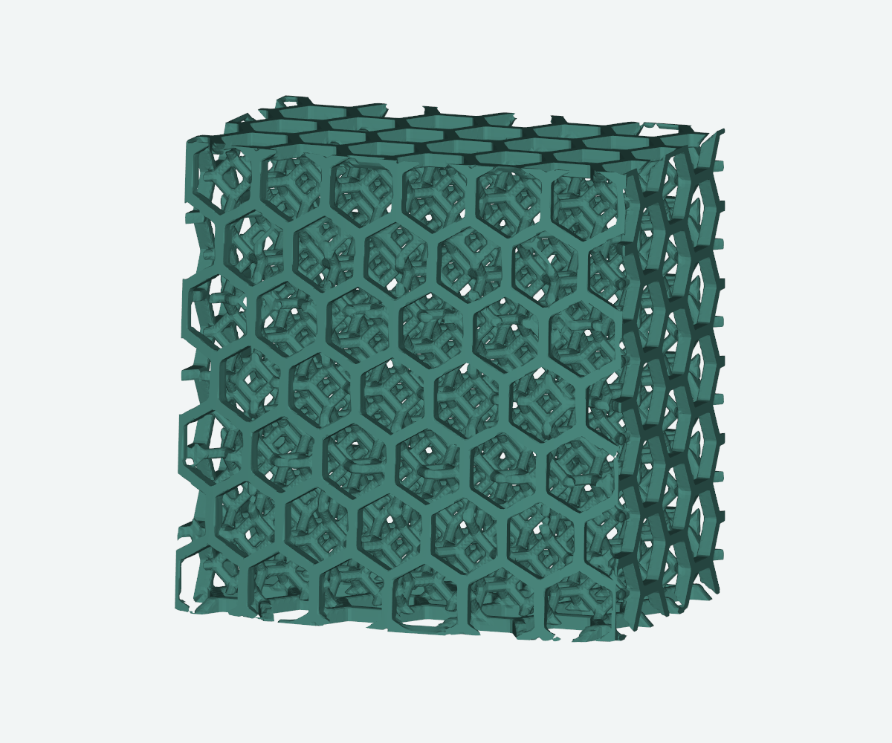
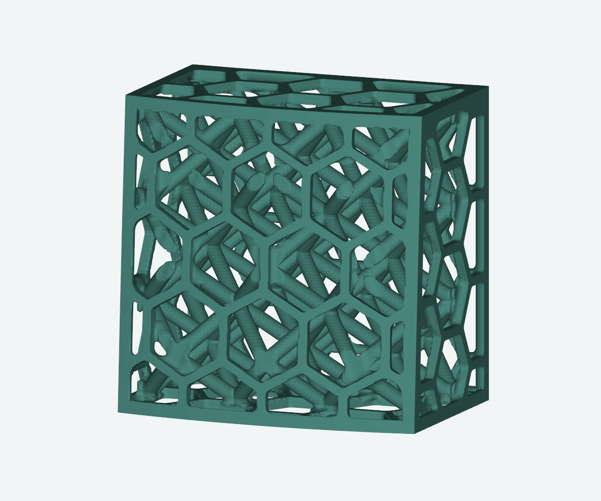

# 右肩晶格：参考件与生成算法对比

## 参考文件

来源：用户提供的 `722机器人-右肩晶格v1.rar`，内含单个二进制 STL，7,966,946 个三角面。
外包尺寸约 128.58 × 128.55 × 149.20 mm，与当前右肩 STEP 的尺寸和位置基本一致。
压缩包没有设计参数，以下区分局部测量与近似拟合。

| 项目 | 参考 STL 局部分析 | 新预设 |
|---|---|---|
| 曲面孔中心距 | 34 个完整孔的中位数约 6.43 mm，10–90% 区间 6.09–7.04 mm | 6.4 mm |
| 六边形孔对边距 | 局部栅格内切圆估计约 5.71 mm | 由孔距、筋宽和圆角决定 |
| 孔间筋宽 | 由孔中心距与孔对边距差值估计约 0.71 mm | 0.7 mm |
| 内部结构 | 主杆方向接近体对角线；BCC 局部拟合优于本次测试的 Kelvin/Cubic | BCC 斜杆网 |
| 内部周期/杆径 | 局部 BCC 拟合约 7.27 / 1.23 mm，残差约 0.25 mm，并非精确反求 | 7.3 / 1.2 mm |
| 曲面与边缘 | 较平整的孔间筋、圆滑孔角、连续边缘 | 原曲面裁切 + 孔角圆滑 + 连接圆滑 + 实边 |

局部测量使用 0.04 mm 栅格及解析环面坐标，受 STL 离散化、曲率和区域选择影响。
上述测量不代表参考件全域等距，也不证明其原始算法就是 BCC。

## 参考件整体外观

## 同一位置的局部形态

参考 STL 中心约 (-257, 0, 1580) mm、边长 24 mm 的观察区域。此图仅截取三角片用于观察；
图中裁切边缘的锯齿/断端来自观察裁切，不视为原件缺陷。

旧配置：Kelvin 周期 4 mm、杆径 0.55 mm、曲面孔距/筋宽跟随内部参数。内芯较密，
表面与内芯频率相近但相位不同，孔后出现大量细杆。

新参考风格：外表面六边形孔距 6.4 mm / 筋宽 0.7 mm，内部 BCC 周期 7.3 mm / 杆径 1.2 mm，
圆滑孔角与过渡，边缘实边 1 mm。孔后结构更加疏朗，保留曲面上的平整材料片段。
此样件由原 STEP 裁出后重新生成，人工切面也会形成孔层和实边，与参考观察切片的边界不同。

## 验证与限制

新局部结果：342,028 个三角面，单一闭合连通体，微小孤立碎片清理数为 0，已按原曲面网格裁切。
样件体积比约 16.3%，包含人工裁切面和实边效应；不能将它与参考整件体积比直接比较。
参数固定后密度由几何决定，没有自动宣称达到 20% 或匹配参考件重量。

参考文件、原 STEP 和历史结果均未覆盖。本次完成算法改动和真实模型局部验证，未进行完整右肩高内存重算。

[打开新算法局部结果](http://127.0.0.1:8765/?review=affe8203d6ee4a88bb0bf301)

界面右侧点击“应用右肩参考件风格”可载入参数，仍可自由修改。
预设不改变橙色保留面，需内外贯通时应取消相应内侧面的保留标记。
